<!-- HOW TO EDIT - Text sections (About, Build, Exploring, Connect): normal text, edit directly. - Typing line : change lines=... in the typing URL (separate lines with ; and use + for spaces). - Skill badges: edit or copy one  line. Colors are hex codes (e.g. 22D3EE). - Hero and section titles: open assets/hero.svg or assets/section_*.svg and change the text. - Keep the "assets" folder next to this README.md. --> 
  
 
  
   <!-- ======================= ABOUT ======================= --> 

 
 I'm an <b>Oracle APEX developer from India</b>, based in <b>Nairobi, Kenya</b>, building enterprise systems on Oracle Database. I take modules from requirements and data model to PL/SQL logic, UI and go-live, and I enjoy turning business requirements into clean, fast and maintainable low-code solutions. 
 <ul> <li>Software Specialist at <b>Eastern Software Systems Africa Ltd.</b> (Software Engineer since 2023, then Senior Software Engineer)</li> <li>Certified <b>Oracle APEX Cloud Developer Professional</b></li> <li>Diploma in Computer Science and Engineering, Govt. MMIT Polytechnic Shravasti (2019 - 2022)</li> <li>Running R&amp;D on newer APEX capabilities and sharing what I learn as I build</li> <li>Fun fact: <b>I can sing really well</b></li> </ul> <!-- ======================= TECH STACK ======================= --> 

 
<b>Oracle platform</b>
 
      
 
<b>Web and integration</b>
 
        
 
<b>Servers and tools</b>
 
      
 <!-- ======================= WHAT I BUILD ======================= --> 

 <table width="100%"> <tr valign="top"> <td width="50%" align="center">   <b>ERP Modules</b>  Production Planning, Equipment Maintenance, Workshop Management and more, built end-to-end </td> <td width="50%" align="center">   <b>Database &amp; PL/SQL</b>  Procedures, functions, triggers and cursors, with query optimization for high-volume reporting </td> </tr> <tr valign="top"> <td width="50%" align="center">   <b>API Integrations</b>  KRA TIMS, KRA PIN and Invoice Checker, Safaricom M-Pesa, WhatsApp and Telegram webhooks </td> <td width="50%" align="center">   <b>UI / UX</b>  Rich APEX interfaces using JavaScript, jQuery, Ajax, HTML5 and CSS3 </td> </tr> </table> <!-- ======================= CURRENTLY EXPLORING ======================= --> 

 
    
 <!-- ======================= GITHUB STATS (optional) ======================= Uncomment this block once your public activity grows. Cards with 0 values look weak right now. Tip: Settings > Profile > "Include private contributions on my profile". 
   
 --> <!-- ======================= CONNECT ======================= --> 

 
     
 
Email: <b>saurabh.data.91@gmail.com</b>
 
  

